# Surrogate Modeling and Bayesian Optimization for Heat Sink Design

**Thermal design · Design of Experiments · Gaussian Processes · Bayesian Optimization · Sensitivity Analysis**

This project investigates the use of surrogate models and Bayesian optimization to reduce the number of simulations required for heat sink design. An analytical thermal model is used to evaluate candidate geometries, while machine learning approximates the relationship between design parameters and thermal performance.

The case study considers a fan-cooled aluminum heat sink for a 60 W chip. The design must satisfy a maximum mass of 150 g and a minimum fin gap of 1 mm.

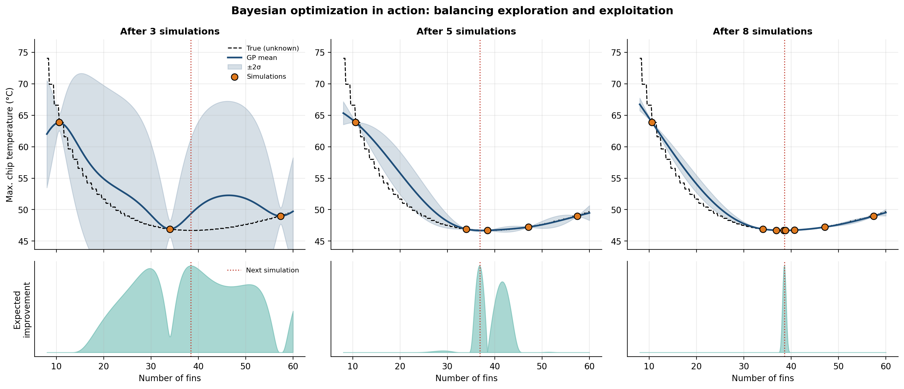

## Results

| Design | Maximum chip temperature | Mass |
|---|---:|---:|
| Baseline design | 53.5 °C | 136 g |
| Bayesian optimization (50 simulations) | **46.7 °C** | 150 g |
| Lightest design matching the baseline temperature | 52.6 °C | **47 g** |

The experiments produced the following results:

- Bayesian optimization reduced the maximum chip temperature by 6.8 °C relative to the baseline while remaining within the same mass limit.
- At a comparable temperature, the lightest design reduced mass by approximately 65%.
- With a budget of 50 simulations, Bayesian optimization reached a median temperature gap of 0.01 °C from the known optimum. Differential evolution required 1,367 simulator evaluations to get within 0.1 °C of the optimum, while random search remained 0.85 °C above it under the same 50-evaluation budget.
- With 80 training simulations, the Gaussian process achieved a mean prediction error of 2.8% on unseen designs, compared with 6.7% for a quadratic response surface and 15.6% for a random forest.

## Workflow

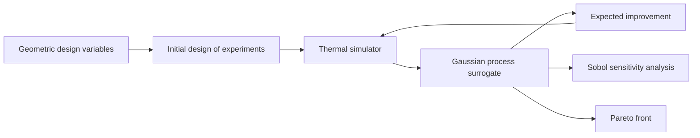

## Thermal model

The simulator represents a ducted plate-fin heat sink using engineering correlations for pressure drop, forced convection, fin efficiency, base spreading resistance, and fan performance. The correlations are based on established work, including Muzychka and Yovanovich, Teertstra et al., and Lee et al.

The airflow rate is determined by the operating point where the fan pressure curve intersects the flow resistance of the heat sink. Consequently, increasing the number of fins does not necessarily improve cooling: additional surface area can be offset by increased flow resistance.

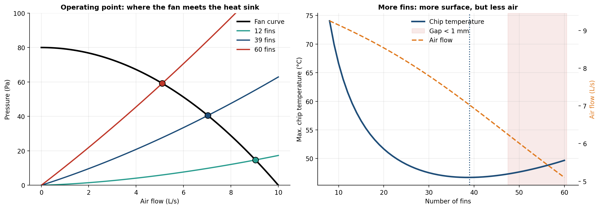

The analytical model is used in place of a CFD solver to keep the experiments reproducible and computationally inexpensive. Because the design space is sufficiently small to identify the optimum with a separate numerical search, it also provides a reference for comparing optimization methods.

The optimization workflow is not tied to this particular simulator. The evaluation function could be replaced by a CFD or FEA solver without changing the overall surrogate-based approach.

## Surrogate models

Three models are compared: a Gaussian process, a quadratic response surface, and a random forest. Each is trained to predict log thermal resistance and evaluated on 2,000 unseen designs.

The quadratic response surface provides a useful baseline for design-of-experiments studies, but its prediction error levels off because the response is not adequately described by a quadratic function. The Gaussian process performs better as additional simulations become available, with its error falling below 2% at 160 training simulations.

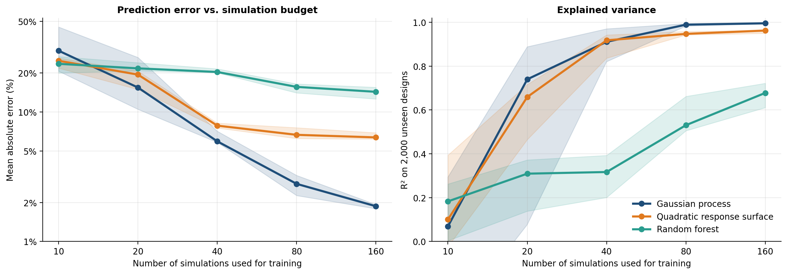

The Gaussian process also estimates predictive uncertainty. Before calibration, its nominal 90% prediction intervals cover 87% of the unseen designs. This indicates that the intervals are somewhat too narrow for the evaluated sample. Conformal calibration, as used in my [RUL prediction project](https://github.com/evelyn-almeida/cmapss-rul-uncertainty), is a possible extension.

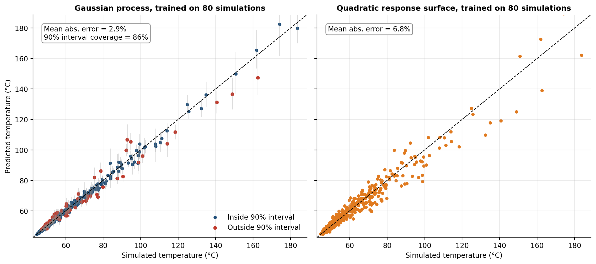

The response surface below illustrates how the model represents the design space using 80 simulations. The estimated uncertainty helps identify regions where additional evaluations could improve the surrogate.

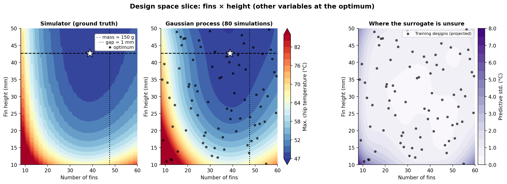

## Sensitivity analysis

Sobol indices are used to assess how the design variables contribute to variation in maximum chip temperature. The indices are first calculated using the simulator and then estimated using the surrogate model.

The direct calculation requires 57,344 simulator evaluations, whereas the surrogate-based analysis uses 80 training simulations.

Fin thickness relative to pitch, fin count, and fin height are the main contributors to temperature variation. Their total Sobol indices exceed their first-order indices, indicating that interactions between variables are relevant. Base thickness has a comparatively small effect within the investigated parameter ranges.

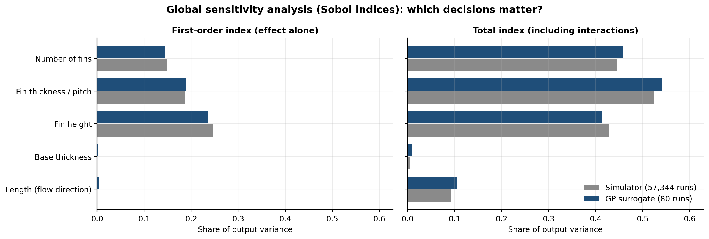

## Bayesian optimization

Bayesian optimization selects new designs using a Gaussian process fitted to the available simulation results. The expected improvement acquisition function balances exploitation, which favors designs predicted to perform well, and exploration, which favors regions with greater uncertainty.

Geometric constraints, including the mass limit and minimum fin gap, are checked before candidate designs are evaluated.

The comparison starts from the same 10-point space-filling design for each method. The convergence curves report the median and interquartile range across 10 independent runs.

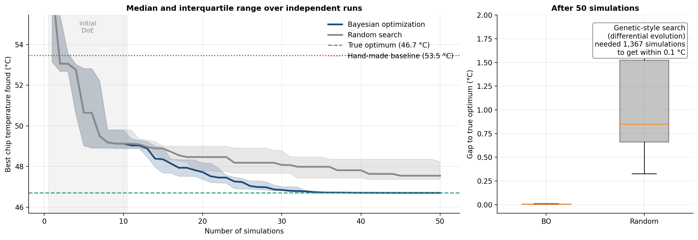

## Temperature and mass trade-off

Reducing chip temperature and reducing heat sink mass are competing objectives. The Pareto front summarizes the designs for which neither objective can be improved without worsening the other.

The surrogate-based front is compared with the reference front obtained from the simulator. Candidate designs identified by the surrogate are evaluated with the simulator before being included in the comparison.

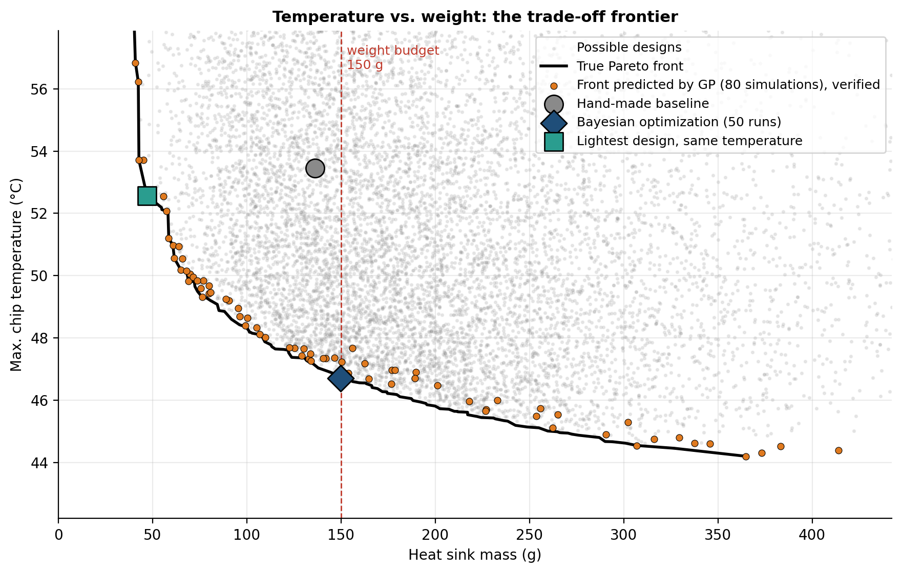

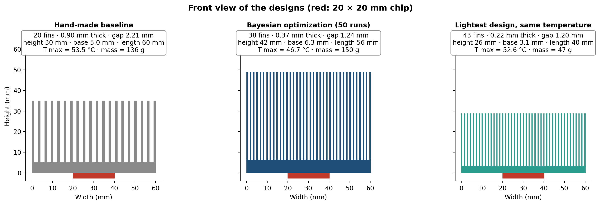

The thermal resistance breakdown helps explain the difference between the baseline and optimized geometries. The optimized design uses a different combination of fin count, thickness, and height to reduce thermal resistance while accounting for the effect of the geometry on airflow.

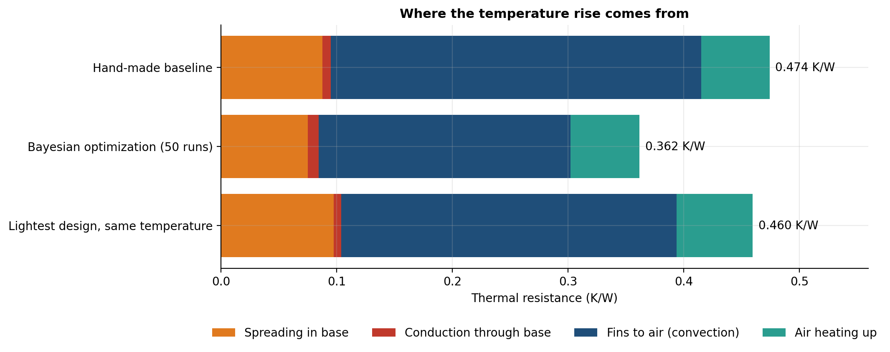

## Design variables and constraints

| Variable | Range or value |
|---|---|
| Number of fins | 8–60 |
| Fin thickness / fin pitch | 0.15–0.60 |
| Fin height | 10–50 mm |
| Base thickness | 2–10 mm |
| Length along the flow direction | 40–100 mm |

The following parameters are fixed:

- Heat sink width: 60 mm
- Chip dimensions: 20 × 20 mm
- Chip power dissipation: 60 W
- Ambient temperature: 25 °C
- Material: aluminum 6063
- Fan maximum pressure: 80 Pa
- Fan free-flow rate: 10 L/s

The optimization considers a maximum mass of 150 g and a minimum fin gap of 1 mm.

## Project structure

```text
├── config.py
├── run.py
├── src/
│   ├── simulator.py
│   ├── sampling.py
│   ├── surrogates.py
│   ├── optimization.py
│   ├── sensitivity.py
│   └── plots.py
├── tests/
│   └── test_core.py
├── figures/
└── results/
```

- `config.py`: design ranges, constraints, baseline geometry, and experiment settings.
- `run.py`: executes the study.
- `src/simulator.py`: analytical thermal model.
- `src/sampling.py`: Latin hypercube sampling and feasibility checks.
- `src/surrogates.py`: Gaussian process, quadratic response surface, and random forest.
- `src/optimization.py`: Bayesian optimization, expected improvement, random search, and Pareto analysis.
- `src/sensitivity.py`: Sobol sensitivity analysis.
- `src/plots.py`: figure generation.
- `tests/test_core.py`: unit tests, including a Sobol index check using the Ishigami function.
- `figures/`: generated plots.
- `results/`: CSV, JSON, and Markdown outputs.

## Installation and execution

Create and activate a virtual environment, then install the dependencies.

```powershell
python -m venv .venv
.venv\Scripts\Activate.ps1
pip install -r requirements.txt
```

```bash
python -m venv .venv
source .venv/bin/activate
pip install -r requirements.txt
```

Run the experiments:

```bash
python run.py --quick
python run.py
pytest
```

The `--quick` option runs a reduced version of the study. Without it, the full experiment suite is executed. Runtime depends on the machine and the experiment settings.

## Limitations and future work

- The thermal model assumes fully ducted airflow, uniform heat flux, and constant air properties. CFD simulations or experimental measurements would be needed to validate the absolute temperature predictions under more realistic conditions.
- Fin count is an integer variable handled through rounding. A mixed-integer surrogate or optimization method could represent this constraint more directly.
- The current study focuses on a single-objective temperature optimization subject to a mass constraint. Multi-objective Bayesian optimization could instead handle temperature and mass simultaneously.
- Other extensions include multi-fidelity optimization combining analytical correlations with a smaller number of CFD evaluations, and robust design optimization accounting for manufacturing tolerances.

## References

- J. Snoek, H. Larochelle, and R. P. Adams. “Practical Bayesian Optimization of Machine Learning Algorithms.” *Advances in Neural Information Processing Systems*, 2012.
- D. R. Jones, M. Schonlau, and W. J. Welch. “Efficient Global Optimization of Expensive Black-Box Functions.” *Journal of Global Optimization*, 1998.
- A. Saltelli et al. “Variance Based Sensitivity Analysis of Model Output.” *Computer Physics Communications*, 2010.
- P. Teertstra, M. M. Yovanovich, and J. R. Culham. “Analytical Forced Convection Modeling of Plate Fin Heat Sinks.” *IEEE SEMI-THERM*, 1999.
- Y. S. Muzychka and M. M. Yovanovich. “Modeling Friction Factors in Non-Circular Ducts for Developing Laminar Flow.” *AIAA Theoretical Fluid Mechanics Meeting*, 1998.
- S. Lee, S. Song, V. Au, and K. P. Moran. “Constriction/Spreading Resistance Model for Electronics Packaging.” *ASME/JSME Thermal Engineering Conference*, 1995.

## Author

**Evelyn Natalie Aguiar de Almeida**

Mechanical Engineer · M.Sc. in Computer Science · Ph.D. Student in Computer Science